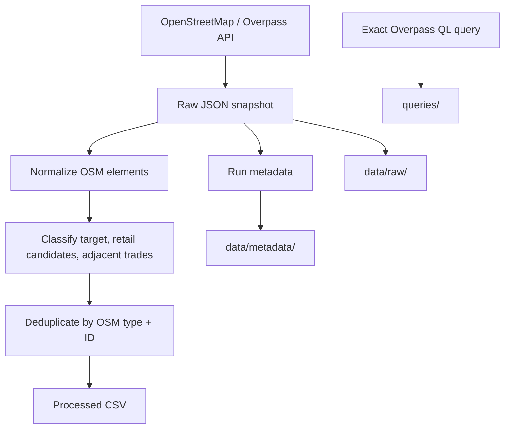
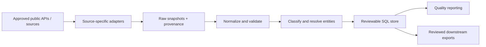

<div align="center">

# Home Services Lead Intelligence

**A provenance-first public business-data discovery pipeline for Egypt's home-services market.**

[](https://www.python.org/)
[](https://github.com/Sohila-Khaled-Abbas/home-services-lead-intelligence/actions/workflows/tests.yml)
[](LICENSE)
[](docs/project-status.md)
[](https://www.openstreetmap.org/copyright)

<br/>

*Discover responsibly. Preserve provenance. Make every record auditable.*

</div>

---

> [!IMPORTANT]
> This is an **in-progress portfolio engineering project**. It is not a production lead database and does not claim that public contact details are permission for outbound marketing. The current live-source implementation is an OpenStreetMap (OSM) discovery prototype; additional Egyptian sources are still being evaluated.

## Project at a glance

| | |
|---|---|
| **Market** | Egypt |
| **Initial search area** | Cairo metro — broad rectangular bounding box |
| **Target segments** | Solar / photovoltaic, HVAC, roofing |
| **Current source adapter** | OpenStreetMap via Overpass API |
| **Core stack** | Python, Requests, pytest, GitHub Actions |
| **Current phase** | Source discovery and extraction foundations |

### Verified baseline — November 4, 2026

The latest committed Overpass extraction returned HTTP 200 and **4 unique mapped OSM elements**. All four were adjacent-trade records—not qualified Solar, HVAC, or Roofing businesses.

| Classification | Mapped elements |
|---|---:|
| Adjacent plumbing | 2 |
| Adjacent electrical | 2 |
| Solar / HVAC / roofing target matches | 0 |
| **Total** | **4** |

One of the four records contains at least one public contact field. This does not establish active business status, service eligibility, or permission to contact. The earlier narrower HVAC/roofing query returned zero matches.

> **Interpretation:** this is a measured result from one source and one configured geography, not evidence that Cairo has no Solar, HVAC, or Roofing providers. OSM coverage is community-maintained and can be incomplete.

---

## Table of contents

- [Project objective](#project-objective)
- [Current implementation](#current-implementation)
- [Architecture](#architecture)
- [Repository structure](#repository-structure)
- [Quick start](#quick-start)
- [Run and test](#run-and-test)
- [Data governance](#data-governance)
- [Roadmap](#roadmap)
- [Documentation](#documentation)
- [Contributing](#contributing)
- [Licensing and citation](#licensing-and-citation)

## Project objective

Build a reproducible data pipeline that discovers publicly documented home-services businesses in Egypt, preserves field-level source provenance, standardizes and validates source records, evaluates data quality, and eventually produces reviewable datasets for downstream analytics.

The target business segments are:

- **Solar / photovoltaic:** installers and service providers, distinguished from equipment retailers and solar assets.
- **HVAC:** air-conditioning, heating, ventilation, and maintenance service providers, distinguished from retailers.
- **Roofing:** roofing contractors, distinguished from adjacent waterproofing and insulation providers.

Plumbing and electrical records are retained as adjacent-trade discovery evidence. They are not counted as target-segment leads.

## Current implementation

<details open>
<summary><strong>Implemented and evidenced</strong></summary>

- Read-only data retrieval through the OpenStreetMap Overpass API.
- Eight explicit OSM tag selectors spanning target trades, retail candidates, and adjacent trades.
- Handling of node coordinates and way/relation center coordinates.
- Conservative classification with an explanatory classification note.
- Stable within-source deduplication using `(osm_type, osm_id)`.
- Preservation of the original JSON response before transformation.
- UTF-8 CSV output with a stable schema, including zero-result runs.
- Run metadata containing the endpoint, query path, bounding box, timestamps, record counts, output paths, and limitations.
- Contact permission defaults to `unknown`; campaign eligibility defaults to `false`.
- Offline unit tests using a fake API response, so tests do not depend on Overpass availability.

</details>

<details>
<summary><strong>Not implemented yet — planned, not claimed</strong></summary>

- NREA Solar-company ingestion.
- Permitted HVAC and roofing directory or API adapters.
- BeautifulSoup / Scrapy website extraction.
- Selenium / Playwright browser automation.
- Cross-source entity resolution and fuzzy matching.
- SQL persistence (SQLite first, PostgreSQL after the model stabilizes).
- Human-reviewed campaign exports.
- Power BI data-quality dashboard.

</details>

## Architecture

### Current OSM extraction flow



### Intended multi-source pipeline



The second diagram is a target architecture, not a description of features already delivered. Each future adapter must have documented access conditions, reuse terms, attribution requirements, and a source-specific identity before it is enabled.

## Repository structure

```text
home-services-lead-intelligence/
├── .github/
│   ├── ISSUE_TEMPLATE/
│   ├── workflows/
│   ├── dependabot.yml
│   └── PULL_REQUEST_TEMPLATE.md
├── data/
│   ├── metadata/       # Committed run metadata
│   ├── processed/      # Committed baseline CSV snapshots
│   └── raw/            # Committed baseline OSM JSON snapshots
├── docs/
│   ├── architecture.md
│   ├── data-governance.md
│   ├── licensing.md
│   └── project-status.md
├── queries/            # Reproducible Overpass QL
├── scripts/            # CLI entry points
├── src/
│   └── home_services_lead_intelligence/
├── tests/              # Offline unit tests
├── CITATION.cff
├── CODE_OF_CONDUCT.md
├── CONTRIBUTING.md
├── LICENSE
├── SECURITY.md
└── pyproject.toml
```

## Quick start

### Requirements

- Python 3.11 or newer
- Git
- Internet access only when running the live Overpass extraction

### Windows PowerShell

Clone the repository, then move into its folder:

```powershell
git clone https://github.com/Sohila-Khaled-Abbas/home-services-lead-intelligence.git
cd home-services-lead-intelligence
```

Create the virtual environment and install the project:

```powershell
python -m venv .venv
& ".\\.venv\\Scripts\\python.exe" -m pip install -e ".[dev]"
```

If the repository already exists locally, do **not** clone it over the existing folder. Use the safe synchronization steps in [the local-device checkpoint guide](docs/local-workflow.md).

## Run and test

Run the Cairo discovery query (this makes a live, read-only API request):

```powershell
& ".\\.venv\\Scripts\\python.exe" ".\\scripts\\extract_osm_cairo_v2.py"
```

Run the offline test suite:

```powershell
& ".\\.venv\\Scripts\\python.exe" -m pytest
```

Run Ruff lint checks:

```powershell
& ".\\.venv\\Scripts\\python.exe" -m ruff check .
```

Overpass is a shared public service. Avoid rapid repeated requests. A successful HTTP response with zero matches is a valid zero-result extraction, not proof that the source contains no relevant businesses.

## Data governance

Every normalized OSM row retains the OSM element type and ID, feature URL, source name, endpoint, source license, query file, extraction timestamp, and source object timestamp/version when provided. Missing address fields remain blank; the pipeline does not invent a city or country.

**A mapped feature is not automatically a lead.** Records require separate checks for:

1. Business identity and active status.
2. Service fit and target segment.
3. Geographic relevance.
4. Source-specific license and reuse conditions.
5. Duplicate identity across sources.
6. Contact permission and campaign eligibility.

Publicly visible contact details do not establish consent or legal permission for direct marketing. The pipeline therefore defaults to `contact_permission_status = unknown` and `campaign_eligible = false`.

See [Data governance](docs/data-governance.md) and [Licensing](docs/licensing.md) before collecting, committing, or redistributing new records.

## Roadmap

| Phase | Deliverable | Status |
|---|---|---|
| 1 | Repository foundation, OSM extraction, provenance, tests | In progress / foundation added |
| 2 | Review and implement NREA Solar source adapter | Next |
| 3 | Identify permitted HVAC and roofing sources | Planned |
| 4 | Cleaning, validation, and cross-source entity resolution | Planned |
| 5 | SQLite persistence and data-quality reports | Planned |
| 6 | Power BI quality dashboard and reviewed exports | Planned |

Progress will be updated only when the corresponding implementation and evidence exist.

## Documentation

| Document | What it covers |
|---|---|
| [Architecture](docs/architecture.md) | Current flow and target design |
| [Data governance](docs/data-governance.md) | Provenance, collection limits, contact safeguards |
| [Licensing](docs/licensing.md) | Code license versus third-party data licenses |
| [Project status](docs/project-status.md) | Verified milestones and next steps |
| [Local workflow](docs/local-workflow.md) | Safe Git synchronization and checkpoint commands |
| [Contributing](CONTRIBUTING.md) | Development and contribution workflow |
| [Security](SECURITY.md) | Responsible vulnerability reporting |

## Contributing

Issues and pull requests are welcome for reproducible bugs, improvements, and source-evaluation work. Read [CONTRIBUTING.md](CONTRIBUTING.md) first. Any proposed data source must include evidence of its access and reuse conditions.

## Licensing and citation

The original project source code is licensed under the [MIT License](LICENSE). **That license does not relicense OpenStreetMap data or any other third-party data.** OSM data remains subject to [ODbL 1.0](https://opendatacommons.org/licenses/odbl/1-0/) and attribution to [OpenStreetMap contributors](https://www.openstreetmap.org/copyright). Other sources retain their own terms and licenses.

For citation metadata, see [CITATION.cff](CITATION.cff).

---

<div align="center">

**Built as a learning-by-building data engineering portfolio project.**

[Repository](https://github.com/Sohila-Khaled-Abbas/home-services-lead-intelligence) · [Issues](https://github.com/Sohila-Khaled-Abbas/home-services-lead-intelligence/issues) · [Pull requests](https://github.com/Sohila-Khaled-Abbas/home-services-lead-intelligence/pulls)

</div>
